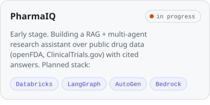
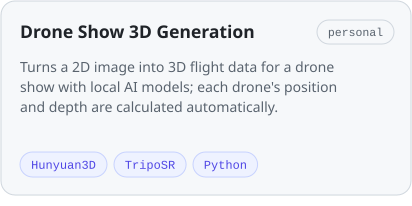
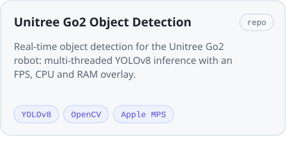
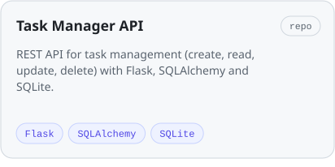
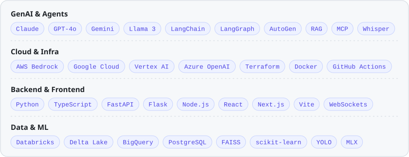

<picture><source media="(prefers-color-scheme: dark)" srcset="assets/dark/header.svg"/></picture>

AI Engineer at Akatsuki AI Technologies in Tokyo. I build agentic AI, RAG and GenAI systems on AWS Bedrock and Google Cloud.

<picture><source media="(prefers-color-scheme: dark)" srcset="assets/dark/h1.svg"/></picture>
<picture><source media="(prefers-color-scheme: dark)" srcset="assets/dark/whoami.svg"/></picture>

<picture><source media="(prefers-color-scheme: dark)" srcset="assets/dark/h2.svg"/></picture>
<picture><source media="(prefers-color-scheme: dark)" srcset="assets/dark/work.svg"/></picture>

<picture><source media="(prefers-color-scheme: dark)" srcset="assets/dark/h3.svg"/></picture>

<picture><source media="(prefers-color-scheme: dark)" srcset="assets/dark/project-pharmaiq.svg"/></picture>
<picture><source media="(prefers-color-scheme: dark)" srcset="assets/dark/project-drone.svg"/></picture>
<a href="https://github.com/jugalsunil17/Unitree_Go2_Project"><picture><source media="(prefers-color-scheme: dark)" srcset="assets/dark/project-go2.svg"/></picture></a>
<a href="https://github.com/jugalsunil17/flask-task-manager-api"><picture><source media="(prefers-color-scheme: dark)" srcset="assets/dark/project-taskmgr.svg"/></picture></a>

<picture><source media="(prefers-color-scheme: dark)" srcset="assets/dark/h4.svg"/></picture>
<picture><source media="(prefers-color-scheme: dark)" srcset="assets/dark/stack.svg"/></picture>

<picture><source media="(prefers-color-scheme: dark)" srcset="assets/dark/h5.svg"/></picture>
<picture><source media="(prefers-color-scheme: dark)" srcset="assets/dark/career.svg"/></picture>

<picture><source media="(prefers-color-scheme: dark)" srcset="assets/dark/h6.svg"/></picture>
<picture><source media="(prefers-color-scheme: dark)" srcset="assets/dark/hobbies.svg"/></picture>

 
Happy to talk about agentic AI, RAG and GenAI in production. Say hi on LinkedIn.

